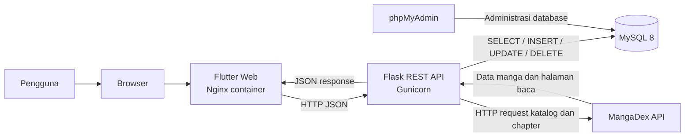
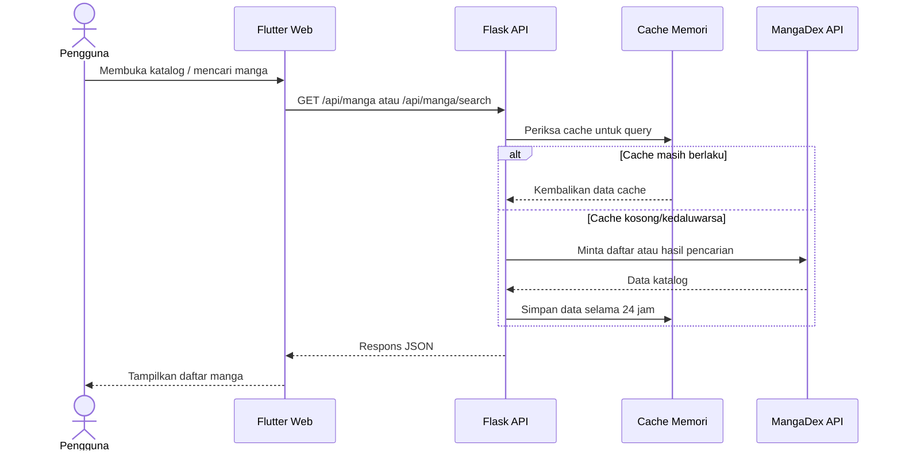
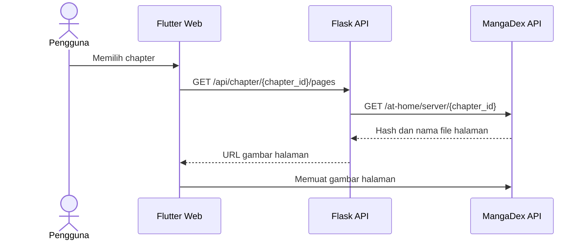
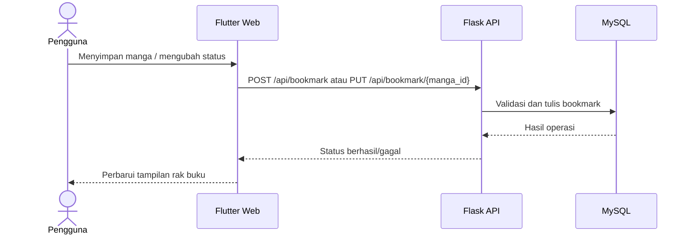
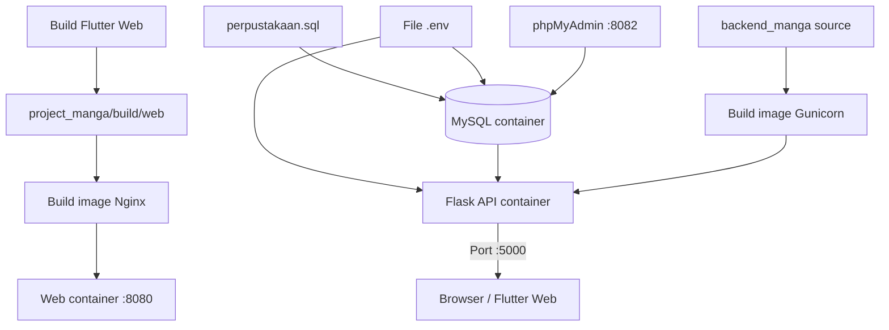
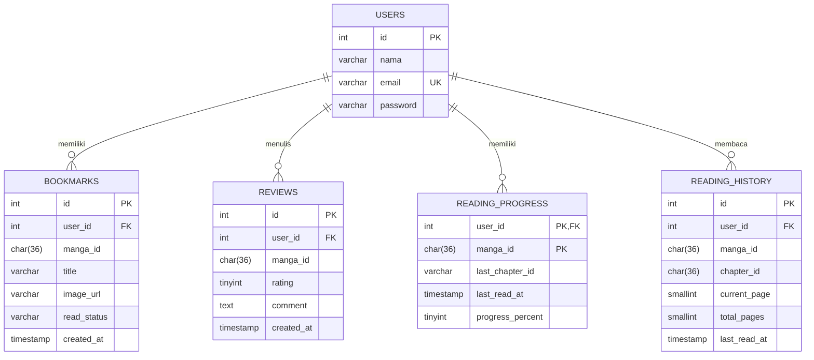
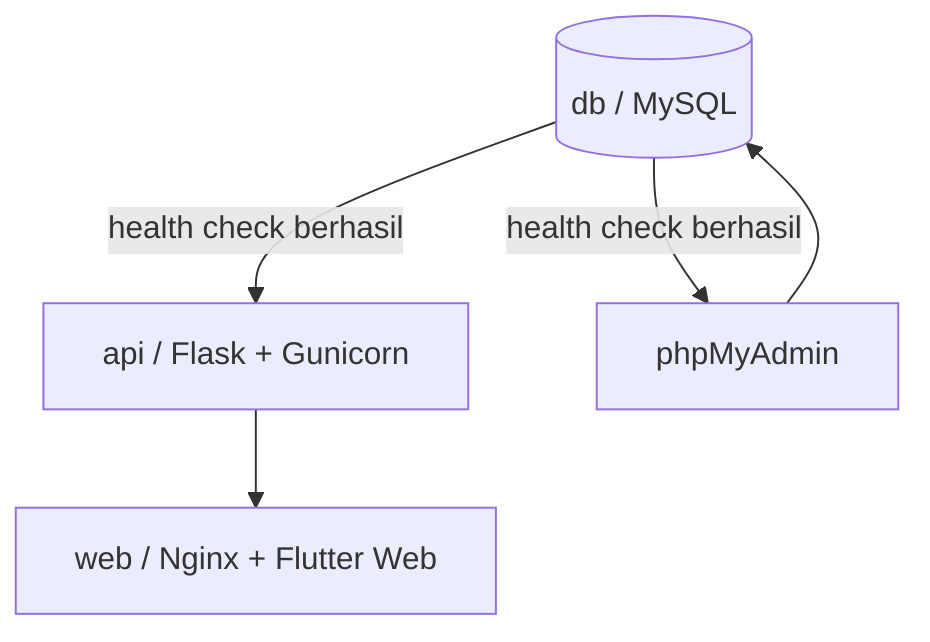
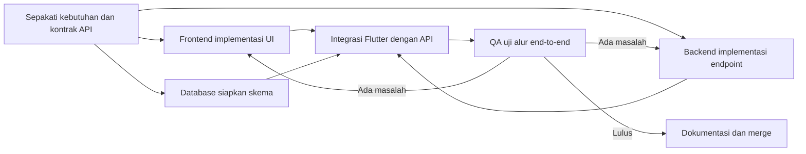

# Mangatsu — Manga Discovery & Personal Library

> Aplikasi katalog manga berbasis Flutter dengan backend Flask, database MySQL, dan deployment lokal menggunakan Docker Compose.

## Daftar Isi

1. [Project Overview](#1-project-overview)
2. [Problem Statement](#2-problem-statement)
3. [Target Users](#3-target-users)
4. [Core Features](#4-core-features)
5. [Optional and Planned Features](#5-optional-and-planned-features)
6. [Application Scope](#6-application-scope)
7. [System Architecture](#7-system-architecture)
8. [Technology Stack](#8-technology-stack)
9. [Database Design](#9-database-design)
10. [CRUD and API Requirements](#10-crud-and-api-requirements)
11. [Docker and Containerization Plan](#11-docker-and-containerization-plan)
12. [Environment Configuration](#12-environment-configuration)
13. [Testing Plan](#13-testing-plan)
14. [Team Responsibilities](#14-team-responsibilities)

---

## 1. Project Overview

**Mangatsu** adalah aplikasi katalog manga untuk menemukan, menelusuri, dan menyimpan manga ke rak buku pribadi. Aplikasi menyediakan antarmuka Flutter Web, REST API Flask, dan penyimpanan akun serta bookmark di MySQL.

Informasi katalog manga dan chapter diperoleh backend melalui **MangaDex API**. Backend menyediakan endpoint untuk daftar manga, pencarian, detail, genre, chapter, dan halaman baca. Data katalog disimpan sementara di cache memori backend selama 24 jam.

### Main Goal

Mangatsu bertujuan menyediakan satu tempat untuk:

- Menemukan manga dari katalog dan pencarian judul.
- Melihat informasi dan detail manga.
- Menjelajahi manga berdasarkan genre.
- Membuat akun dan masuk ke aplikasi.
- Menyimpan manga pilihan ke rak buku pribadi.
- Mengelompokkan bookmark berdasarkan status baca.
- Menjalankan frontend, backend, dan database secara konsisten dengan Docker Compose.

### Project Snapshot

| Area | Implementasi saat ini |
|---|---|
| Nama aplikasi | Mangatsu |
| Jenis aplikasi | Katalog manga dan rak buku pribadi |
| Frontend | Flutter Web |
| Backend | REST API Flask dan Gunicorn |
| Database | MySQL 8 |
| Sumber katalog dan chapter | MangaDex API |
| Orkestrasi lokal | Docker Compose |
| Status autentikasi API | Email/password; belum menggunakan token autentikasi |

---

## 2. Problem Statement

Informasi manga tersebar di berbagai sumber sehingga pengguna perlu berpindah-pindah untuk mencari judul, melihat detail, dan mengingat manga yang ingin dibaca. Daftar simpanan pribadi juga sulit dikelola apabila hanya mengandalkan ingatan atau catatan terpisah.

Mangatsu menggabungkan penjelajahan katalog dengan rak buku pribadi. Pengguna dapat mencari dan membuka informasi manga, kemudian menyimpan manga tersebut dan memperbarui status bacanya.

### Tantangan yang ingin dibantu

| Tantangan pengguna | Dukungan Mangatsu |
|---|---|
| Sulit menemukan judul yang dicari | Pencarian manga berdasarkan judul |
| Sulit menjelajahi katalog berdasarkan minat | Halaman eksplorasi genre |
| Informasi manga perlu dilihat dalam satu halaman | Halaman detail manga |
| Manga pilihan mudah terlupakan | Rak buku/bookmark per akun |
| Sulit mengingat progres baca | Status `plan`, `reading`, dan `completed` |

Mangatsu adalah aplikasi penemuan, pembacaan chapter yang tersedia di MangaDex, dan pengelolaan daftar manga. Mangatsu tidak meng-host atau menyimpan salinan halaman chapter.

---

## 3. Target Users

Mangatsu ditujukan bagi pembaca manga yang ingin menemukan judul dan mengelola daftar bacaan pribadi.

| Kelompok pengguna | Kebutuhan |
|---|---|
| Pembaca manga baru | Menemukan judul dan melihat ringkasan informasinya |
| Pembaca aktif | Mencari manga dan membuka detailnya dengan cepat |
| Pengguna dengan banyak daftar bacaan | Menyimpan manga ke rak buku dan mengatur status baca |
| Pengguna yang ingin menjelajah | Menemukan manga melalui genre |

Pengguna dapat melihat katalog tanpa masuk. Fitur rak buku membutuhkan akun dan `user_id` yang diperoleh dari proses login di aplikasi.

---

## 4. Core Features

Bagian ini merangkum fitur yang ditemukan pada frontend dan backend proyek saat ini.

### 4.1 Manga Catalog and Home

Frontend memuat daftar manga dari backend dan menampilkannya di halaman beranda. Backend meminta daftar manga kepada MangaDex API dan menggunakan cache memori untuk respons yang masih segar.

Fungsi yang tersedia:

- Memuat daftar manga dengan paginasi API.
- Menampilkan kartu manga dengan sampul dan informasi katalog yang tersedia.
- Menyaring atau mengurutkan daftar yang telah dimuat pada sisi aplikasi.
- Menampilkan ranking Trending Harian, Mingguan, dan Bulanan berdasarkan aktivitas baca Mangatsu dalam 1, 7, dan 30 hari terakhir.
- Menampilkan keadaan memuat dan menyediakan aksi untuk mencoba kembali apabila pemuatan gagal.

| Operasi | Endpoint | Hasil |
|---|---|---|
| Memuat daftar manga | `GET /api/manga?page=1` | Daftar manga dari katalog |
| Memuat halaman berikutnya | `GET /api/manga?page={page}` | Halaman daftar yang diminta |
| Memuat ranking trending | `GET /api/manga/trending?period=daily` | Ranking berdasarkan pembaca unik dalam periode `daily`, `weekly`, atau `monthly` |

Ranking trending menggunakan aktivitas pada `reading_history`, bukan angka popularitas katalog. Karena itu, hasil tiap periode bergantung pada data baca Mangatsu yang tercatat dan dapat sama jika aktivitas dalam rentang waktunya sama.

### 4.2 Search

Pengguna dapat mencari manga berdasarkan judul. Pencarian dikirim ke backend dan diteruskan ke MangaDex API.

```text
Masukkan kata kunci
        ↓
Flutter mengirim query pencarian
        ↓
Flask memanggil MangaDex API
        ↓
Hasil pencarian dikirim ke Flutter
```

| Method | Endpoint | Parameter |
|---|---|---|
| `GET` | `/api/manga/search` | `q` untuk query, `page` untuk nomor halaman |

Contoh:

```text
GET /api/manga/search?q=monster&page=1
```

### 4.3 Manga Detail

Halaman detail menampilkan informasi katalog yang tersedia, misalnya judul, sampul, penulis, status, sinopsis, tahun rilis, genre, dan rating. Backend meminta detail lengkap berdasarkan ID manga, lalu menyimpan respons detail sementara di cache.

| Method | Endpoint | Keterangan |
|---|---|---|
| `GET` | `/api/manga/{manga_id}` | Mengambil detail manga berdasarkan UUID MangaDex |
| `GET` | `/api/manga/{manga_id}/chapters` | Mengambil chapter bahasa Indonesia dan Inggris |
| `GET` | `/api/chapter/{chapter_id}/pages` | Mengambil URL halaman baca chapter |

> Ketersediaan chapter bergantung pada unggahan dan bahasa yang tersedia di MangaDex. Filter backend meminta konten berlabel `safe`. Halaman dibaca langsung dari server MangaDex dan tidak disimpan di database Mangatsu.

### 4.4 Genre Exploration

Frontend memiliki halaman eksplorasi dan penyaringan manga berdasarkan genre. Angka pada daftar genre memakai total hasil MangaDex, bukan jumlah dari sampel manga unggulan. Genre dengan total nol tidak ditampilkan. Halaman genre menggunakan paginasi 25 manga per halaman.

| Method | Endpoint | Keterangan |
|---|---|---|
| `GET` | `/api/manga/genre-counts?genres=Action%7CComedy` | Mengambil total manga untuk sejumlah genre |
| `GET` | `/api/manga/genre/{genre_name}?page=1` | Meminta halaman manga berdasarkan tag; respons menyertakan `total` |

### 4.5 Reading Progress and History

Reader menyimpan halaman terakhir yang dibaca per chapter. Saat mencapai akhir chapter, chapter ditandai selesai; riwayat ini menjadi dasar fitur lanjut membaca, persentase progres per manga, dan ranking trending.

| Method | Endpoint | Keterangan |
|---|---|---|
| `GET` | `/api/reading/progress/{manga_id}` | Mengambil progres, chapter terakhir, dan daftar ID chapter selesai untuk pengguna |
| `POST` | `/api/reading/progress` | Menyimpan chapter dan posisi halaman baca |
| `DELETE` | `/api/reading/progress/{manga_id}` | Menghapus progres serta riwayat baca manga |
| `GET` | `/api/reading/summary` | Mengambil ringkasan progres baca pengguna |

### 4.6 Reviews

Halaman detail manga menyediakan ulasan dan rating yang tersimpan di MySQL. Pengguna dapat melihat ulasan manga dan mengirim ulasannya sendiri.

| Method | Endpoint | Keterangan |
|---|---|---|
| `GET` | `/api/manga/{manga_id}/reviews` | Mengambil ulasan untuk manga |
| `POST` | `/api/manga/{manga_id}/reviews` | Mengirim rating dan komentar |

### 4.7 Registration and Login

Pengguna dapat membuat akun dengan nama, email, dan password, kemudian masuk dengan email dan password.

Validasi registrasi backend mencakup:

- Nama 2–100 karakter.
- Email dengan format yang valid.
- Password minimal 8 karakter.
- Email harus belum pernah terdaftar.
- Password disimpan sebagai hash, bukan teks biasa.

Login mengembalikan informasi pengguna yang mencakup ID, nama, dan email. Frontend menyimpan informasi ini dalam sesi aplikasi saat berjalan.

| Method | Endpoint | Data utama |
|---|---|---|
| `POST` | `/api/register` | `name`, `email`, `password` |
| `POST` | `/api/login` | `email`, `password` |

### 4.8 Personal Bookmark Library

Pengguna yang sudah login dapat mengelola daftar manga pribadi:

- Membuat bookmark untuk manga.
- Melihat semua bookmark milik pengguna.
- Memeriksa apakah satu manga sudah disimpan.
- Mengubah status baca.
- Menghapus bookmark.

Status baca yang diterima API:

| Nilai API | Makna |
|---|---|
| `plan` | Ingin dibaca |
| `reading` | Sedang dibaca |
| `completed` | Selesai dibaca |

Relasi pengguna dan bookmark disimpan di MySQL. Satu pengguna tidak dapat mempunyai bookmark duplikat untuk manga yang sama karena ada unique key gabungan `user_id` dan `manga_id`.

### 4.9 Profile and Account Deletion

Halaman profil menyediakan logout dan alur konfirmasi penghapusan akun. Endpoint hapus akun meminta email dan password sebagai konfirmasi. Bookmark yang memiliki foreign key ke akun mengikuti aturan penghapusan cascade database.

| Method | Endpoint | Pengamanan pada implementasi sekarang |
|---|---|---|
| `DELETE` | `/api/delete-account` | Memverifikasi email dan password pada body JSON |

---

## 5. Optional and Planned Features

Fitur pada bagian ini tidak boleh dianggap telah selesai atau tersimpan secara backend sampai ada implementasi dan pengujian yang sesuai.

| Fitur | Status saat ini | Catatan |
|---|---|---|
| Reader chapter MangaDex | Tersedia untuk chapter yang tersedia | Mengambil halaman dari MangaDex; tidak menyimpan halaman |
| Token autentikasi | Belum tersedia | Login belum menerbitkan token dan request bookmark menggunakan `user_id` |
| Sinkronisasi rak buku lintas perangkat yang aman | Perlu penguatan | Memerlukan autentikasi server-side, misalnya session/token |
| Pengaturan base URL per lingkungan | Perlu ditambahkan | URL API saat ini ditulis langsung pada kode frontend |
| Deployment internet/produksi | Di luar konfigurasi lokal saat ini | Perlu HTTPS, konfigurasi CORS, secrets aman, dan endpoint API publik |

---

## 6. Application Scope

### Included in the current project

- Aplikasi Flutter Web untuk katalog dan reader chapter MangaDex.
- Halaman beranda, pencarian, eksplorasi genre, detail, autentikasi, rak buku, dan profil.
- Backend REST API Flask.
- Integrasi backend ke MangaDex API untuk katalog dan chapter.
- Cache katalog sementara di memori backend.
- MySQL untuk akun, bookmark, ulasan, progres chapter, dan riwayat baca.
- Ranking trending berdasarkan aktivitas baca Mangatsu pada rentang harian, mingguan, dan bulanan.
- Docker Compose untuk web, API, database, dan phpMyAdmin.
- Penghapusan akun dengan verifikasi password.

### Not included in the current project

- Meng-host atau menyimpan salinan file manga/chapter.
- Pembelian, pembayaran, atau langganan konten.
- Integrasi OAuth atau sistem token untuk autentikasi request API.
- Sinkronisasi cache antar-replika backend.
- Infrastruktur cloud atau deployment produksi yang diamankan.
- Pemulihan akun, verifikasi email, atau reset password.

### Scope boundaries

| Area | Tanggung jawab Mangatsu | Bukan tanggung jawab Mangatsu |
|---|---|---|
| Informasi manga | Meminta dan menyajikan data katalog dari MangaDex API | Menjadi sumber asli seluruh metadata |
| Reader | Meminta daftar chapter dan URL halaman dari MangaDex API | Meng-host atau menyimpan file chapter |
| Daftar pribadi | Menyimpan UUID MangaDex, judul, gambar, dan status bookmark | Menyimpan file manga |
| Akun | Registrasi, login, dan hapus akun dasar | SSO, MFA, reset password, dan verifikasi email |
| Deployment lokal | Menjalankan service lewat Compose | Menyediakan cluster/cloud produksi |

---

## 7. System Architecture

Mangatsu menggunakan arsitektur client-server. Flutter Web berjalan di browser, Flask menyediakan API, MySQL menyimpan data akun, bookmark, ulasan, dan progres baca, sedangkan MangaDex API menjadi sumber katalog dan chapter eksternal.

### 7.1 Architecture Flow



### 7.2 Request Flow — Katalog Manga



### 7.3 Request Flow — Membaca Chapter



### 7.3 Request Flow — Bookmark



### 7.4 Deployment Flow



> Browser mengirim request API dari sisi client. Untuk penggunaan selain mesin lokal, alamat API di frontend harus menunjuk ke host API yang dapat diakses oleh browser pengguna; `localhost` pada browser pengguna bukan otomatis host server.

---

## 8. Technology Stack

### 8.1 Frontend

| Teknologi | Pemakaian |
|---|---|
| Flutter | Membangun antarmuka aplikasi |
| Dart | Bahasa frontend |
| Flutter Web | Menjalankan aplikasi melalui browser |
| `http` | Mengirim request REST API dan JSON |
| Nginx | Menyajikan hasil build Flutter Web di container |

### 8.2 Backend

| Teknologi | Pemakaian |
|---|---|
| Python 3.12 | Runtime backend pada Dockerfile |
| Flask | Routing REST API |
| Flask-CORS | Mengaktifkan Cross-Origin Resource Sharing |
| Gunicorn | Menjalankan aplikasi Flask pada container |
| PyMySQL | Koneksi dan query MySQL |
| Requests | Mengakses MangaDex API |
| Werkzeug | Hash dan verifikasi password |

### 8.3 Data and Infrastructure

| Teknologi | Pemakaian |
|---|---|
| MySQL 8 | Penyimpanan akun, bookmark, ulasan, dan riwayat/progres baca |
| Docker | Packaging service |
| Docker Compose | Menjalankan dan menghubungkan seluruh service |
| phpMyAdmin | Antarmuka administrasi MySQL untuk lingkungan lokal |
| MangaDex API | Data katalog manga dan metadata chapter eksternal |

### 8.4 External Service Dependency

| Dependensi | Dampak jika tidak tersedia |
|---|---|
| MangaDex API | Katalog, pencarian, detail, chapter, atau halaman baca dapat gagal dimuat |
| Docker image registry | Build pertama memerlukan koneksi untuk mengunduh image dasar |
| Flutter package registry | Pengambilan dependency Flutter memerlukan koneksi saat `flutter pub get` |

---

## 9. Database Design

Database utama bernama `perpustakaan`. Skema SQL proyek mendefinisikan tabel `users`, `bookmarks`, `reviews`, `reading_progress`, dan `reading_history`.

### 9.1 Entity Relationship



`reading_history` mencatat aktivitas chapter per pengguna. Data ini dipakai untuk progres/penyelesaian chapter dan agregasi pembaca unik pada endpoint Trending. Daftar trending merupakan agregasi langsung dari database untuk periode yang diminta, bukan cache popularitas MangaDex.

### 9.2 `users`

| Kolom | Tipe | Aturan | Keterangan |
|---|---|---|---|
| `id` | `int` | Primary key, auto-increment | ID unik akun |
| `nama` | `varchar(100)` | Wajib | Nama pengguna |
| `email` | `varchar(100)` | Wajib, unique | Alamat email login |
| `password` | `varchar(255)` | Wajib | Hash password dari Werkzeug |

### 9.3 `bookmarks`

| Kolom | Tipe | Aturan | Keterangan |
|---|---|---|---|
| `id` | `int` | Primary key, auto-increment | ID bookmark |
| `user_id` | `int` | Foreign key ke `users.id` | Pemilik bookmark |
| `manga_id` | `char(36)` | Wajib | UUID manga dari MangaDex |
| `title` | `varchar(255)` | Wajib | Judul manga yang disimpan |
| `image_url` | `varchar(500)` | Opsional | URL gambar sampul |
| `read_status` | `varchar(20)` | Default `plan` | Status baca |
| `created_at` | `timestamp` | Default waktu saat dibuat | Waktu bookmark dibuat |

### 9.4 Database Constraints

| Constraint | Tujuan |
|---|---|
| Primary key pada `users.id` dan `bookmarks.id` | Identitas unik setiap record |
| Unique key pada `users.email` | Mencegah email akun ganda |
| Unique key pada bookmark dan primary key `(user_id, manga_id)` pada progres | Mencegah bookmark ganda dan menyediakan satu ringkasan progres per manga |
| Unique key gabungan `(user_id, manga_id, chapter_id)` pada riwayat | Satu progres tersimpan untuk setiap chapter per pengguna dan manga |
| Foreign key dari `bookmarks`, `reviews`, `reading_progress`, dan `reading_history` ke `users.id` | Menjaga relasi data dengan pemilik |
| `ON DELETE CASCADE` pada relasi pengguna | Menghapus data terkait ketika akun dihapus |

### 9.5 Data Persistence and Cache

- Data MySQL disimpan pada named volume Docker `mysql_data`.
- `perpustakaan.sql` dipasang sebagai skrip inisialisasi database pada container MySQL.
- Skrip inisialisasi image MySQL dijalankan saat direktori data database masih kosong; perubahan SQL tidak otomatis diterapkan ke volume yang sudah terisi.
- Cache katalog disimpan di memori proses backend, bukan di MySQL. Cache akan hilang saat proses/container backend dimulai ulang dan tidak dibagi antar-worker Gunicorn.
- UUID MangaDex disimpan sebagai `CHAR(36)` di bookmark.
- Migrasi provider menghapus bookmark lama yang memakai ID MAL numerik, sesuai pilihan reset, tetapi mempertahankan akun. Lihat `backend_manga/database/migrate_mangadex.sql`.

---

## 10. CRUD and API Requirements

Base URL lokal:

```text
http://localhost:5000
```

Request yang mengirim body JSON perlu menyertakan:

```http
Content-Type: application/json
```

### 10.1 Manga Catalog API

| Method | Endpoint | Parameter | Keterangan |
|---|---|---|---|
| `GET` | `/api` | — | Health check API |
| `GET` | `/api/health` | — | Health check API |
| `GET` | `/api/manga` | `page` | Daftar manga |
| `GET` | `/api/manga/trending` | `period`: `daily`, `weekly`, atau `monthly` | Ranking berdasarkan pembaca unik dalam 1, 7, atau 30 hari terakhir |
| `GET` | `/api/manga/search` | `q`, `page` | Pencarian manga |
| `GET` | `/api/manga/{manga_id}` | Path: UUID MangaDex | Detail manga |
| `GET` | `/api/manga/genre-counts` | Query: `genres`, dipisahkan `\|` | Total hasil MangaDex per genre |
| `GET` | `/api/manga/genre/{genre_name}` | Path: nama tag; query: `page` | Daftar manga berdasarkan tag; respons menyertakan `total` |
| `GET` | `/api/manga/{manga_id}/chapters` | Path: UUID manga; query: `page`, `language` (`id`/`en`) | Daftar chapter |
| `GET` | `/api/chapter/{chapter_id}/pages` | Path: UUID chapter | URL gambar halaman chapter |
| `GET` | `/api/manga/{manga_id}/reviews` | Path: UUID manga | Daftar ulasan |
| `POST` | `/api/manga/{manga_id}/reviews` | Path dan body JSON | Membuat ulasan |
| `GET` | `/api/reading/progress/{manga_id}` | Path: UUID manga | Progres, chapter terakhir, dan chapter selesai |
| `POST` | `/api/reading/progress` | Body JSON | Menyimpan posisi baca |
| `DELETE` | `/api/reading/progress/{manga_id}` | Path: UUID manga | Menghapus progres serta riwayat manga |
| `GET` | `/api/reading/summary` | Query `user_id` sesuai implementasi login | Ringkasan baca pengguna |

Chapter berbahasa Indonesia diminta bersama chapter berbahasa Inggris sebagai fallback. Endpoint chapter mengembalikan maksimal 100 chapter per halaman; endpoint halaman mengembalikan URL gambar MangaDex.

### 10.2 Account API

| Method | Endpoint | Body JSON | Respons umum |
|---|---|---|---|
| `POST` | `/api/register` | `name`, `email`, `password` | Akun baru; `201` bila berhasil |
| `POST` | `/api/login` | `email`, `password` | Informasi akun; `200` bila berhasil |
| `DELETE` | `/api/delete-account` | `email`, `password` | Akun dihapus bila kredensial cocok |

Contoh registrasi:

```json
{
  "name": "Nama Pengguna",
  "email": "pengguna@example.com",
  "password": "password-minimal-8-karakter"
}
```

### 10.3 Bookmark API

| Operasi | Method dan endpoint | Lokasi `user_id` | Data tambahan |
|---|---|---|---|
| Melihat semua bookmark | `GET /api/bookmark?user_id=1` | Query string | — |
| Menambahkan bookmark | `POST /api/bookmark` | Body JSON | `manga_id`, `title`, `image_url` |
| Memeriksa satu bookmark | `GET /api/bookmark/{manga_id}?user_id=1` | Query string | ID manga di path |
| Mengubah status baca | `PUT /api/bookmark/{manga_id}` | Body JSON | `read_status` |
| Menghapus bookmark | `DELETE /api/bookmark/{manga_id}?user_id=1` | Query string | ID manga di path |

Contoh membuat bookmark:

```json
{
  "user_id": 1,
  "manga_id": "6b3bfc9e-4e78-4c12-8dcb-dc5e0bb682cf",
  "title": "Judul Manga",
  "image_url": "https://example.com/cover.jpg"
}
```

Contoh memperbarui status baca:

```json
{
  "user_id": 1,
  "read_status": "reading"
}
```

### 10.4 Validation and Error Responses

| Situasi | Respons yang diharapkan |
|---|---|
| Input registrasi tidak valid | `400 Bad Request` |
| Email sudah terdaftar | `409 Conflict` |
| Kredensial login salah | `401 Unauthorized` |
| `user_id` bookmark tidak dikirim | Endpoint bookmark tertentu menolak request |
| Nilai `read_status` tidak diizinkan | `400 Bad Request` |
| Bookmark untuk update tidak ditemukan | `404 Not Found` |
| Penghapusan akun terhalang relasi database | `409 Conflict` |
| MangaDex API timeout atau tidak tersedia | Error gateway/service dari backend |

> Catatan keamanan: autentikasi login saat ini tidak menghasilkan token. Endpoint bookmark mempercayai `user_id` yang dikirim client. Ini sesuai implementasi sekarang, tetapi belum cukup untuk melindungi data pengguna pada deployment publik.

---

## 11. Docker and Containerization Plan

Docker Compose mendefinisikan empat service:

| Service Compose | Container | Port host | Fungsi |
|---|---|---:|---|
| `db` | `manga_db` | — | MySQL dan penyimpanan database |
| `phpmyadmin` | `manga_pma` | `8082` | Administrasi database |
| `api` | `manga_api` | `5000` | Flask API dan integrasi MangaDex |
| `web` | `manga_web` | `8080` | Flutter Web yang disajikan Nginx |

### Docker Hub Images

| Sumber | Keterangan | Link |
|---|---|---|
| Docker Hub: mangatsu-api | Image backend Flask buatan kelompok | [https://hub.docker.com/r/carlossiregar/mangatsu-api](https://hub.docker.com/r/carlossiregar/mangatsu-api) |
| Docker Hub: mangatsu-web | Image frontend Flutter buatan kelompok | [https://hub.docker.com/r/carlossiregar/mangatsu-web](https://hub.docker.com/r/carlossiregar/mangatsu-web) |

### 11.1 Service Dependencies



Database memiliki health check. API dan phpMyAdmin menunggu database sehat sebelum dimulai. `depends_on` pada web mengatur urutan start service, tetapi bukan health check kesiapan endpoint API.

### 11.2 First Run After Clone

Prasyarat untuk menjalankan seluruh aplikasi:

- Git.
- Docker Desktop dengan Docker Compose aktif.
- Flutter SDK stable yang kompatibel dengan `project_manga/pubspec.yaml`.
- Akses internet untuk mengambil dependency, image Docker, dan data MangaDex.

Clone repository lalu masuk ke root project:

```
git clone https://github.com/carlos1739/mangatsu.git
cd mangatsu
```

Buat file konfigurasi lokal dari template, lalu edit password database contoh sebelum menjalankan container:

```
copy .env.example .env
notepad .env
```

Isi `MYSQL_ROOT_PASSWORD` dan `DB_PASSWORD` dengan password lokal pilihanmu. Pastikan `DB_NAME` dan `DB_USER` tetap konsisten dengan konfigurasi contoh, dan jangan commit file `.env`.

Build aset Flutter Web dan mulai semua service:

```
cd project_manga
flutter pub get
flutter build web --release
cd ..
docker compose up --build -d
docker compose ps
```

Tunggu sampai service `db` berstatus `healthy` dan `api` serta `web` berstatus `running`. Pemeriksaan endpoint:

```
curl.exe http://localhost:5000/api/health
curl.exe -I http://localhost:8080
```

Buka **http://localhost:8080** untuk menggunakan aplikasi. phpMyAdmin tersedia di **http://localhost:8082**. Build pertama dapat memerlukan waktu karena Docker mengunduh image dan Flutter mengambil package. Image web menyalin hasil `project_manga/build/web` ke Nginx, jadi build Flutter harus berhasil sebelum image web dibuat.

Pada clone pertama, Docker membuat volume database dan menginisialisasi tabel dari `backend_manga/perpustakaan.sql`. Inisialisasi ini hanya berjalan ketika volume MySQL masih kosong; menjalankan ulang Compose tidak menghapus data atau menerapkan ulang skrip SQL.

Alamat lokal:

| Aplikasi | URL |
|---|---|
| Mangatsu Web | http://localhost:8080 |
| Flask API health check | http://localhost:5000/api/health |
| phpMyAdmin | http://localhost:8082 |

### 11.3 Common Operations

```powershell
# Lihat status container
docker compose ps

# Lihat log backend
docker compose logs -f api

# Lihat log database
docker compose logs -f db

# Hentikan container, pertahankan data volume
docker compose down
```

> `docker compose down -v` menghapus named volume `mysql_data` dan seluruh data database lokal. Gunakan hanya jika memang ingin menghapus data tersebut.

#### Migrasi database dari Tenrai ke MangaDex

Jika database MySQL sudah pernah berjalan, skrip inisialisasi tidak dijalankan ulang otomatis. Jalankan migrasi satu kali dari root repository:

```powershell
Get-Content backend_manga/database/migrate_mangadex.sql | docker compose exec -T db sh -c 'mysql -uroot -p"$MYSQL_ROOT_PASSWORD" "$MYSQL_DATABASE"'
```

Migrasi ini menghapus bookmark lama karena ID MAL numerik tidak dapat dipakai sebagai UUID MangaDex. Akun pengguna tetap dipertahankan. Setelah migrasi, build ulang API dan web:

```powershell
docker compose up --build -d api web
```

### 11.4 Run Flutter Locally with Containerized Backend

```powershell
# Dari root repository: mulai database dan API
docker compose up --build -d db api

# Di terminal lain
cd project_manga
flutter pub get
flutter run -d chrome
```

Frontend lokal menggunakan base URL API yang didefinisikan di kode Flutter. Perangkat Android emulator memiliki aturan alamat host yang berbeda dari browser desktop; samakan konfigurasi URL dengan target yang digunakan.

---

## 12. Environment Configuration

### 12.1 Root `.env`

Salin `.env.example` menjadi `.env` di direktori yang sama dengan `docker-compose.yml`, lalu ganti password contoh untuk penggunaan lokal:

```powershell
Copy-Item .env.example .env
```

Compose meneruskan nilai tersebut ke container MySQL dan API. `.env.example` boleh di-commit karena hanya berisi contoh; `.env` lokal tetap diabaikan oleh Git. Jangan menaruh password produksi di README, source code, atau repository.

### 12.2 Backend Variables

| Variabel | Penggunaan | Default di kode |
|---|---|---|
| `DB_HOST` | Host MySQL | `127.0.0.1` |
| `DB_PORT` | Port MySQL | `3306` |
| `DB_USER` | User MySQL | `root` |
| `DB_PASSWORD` | Password MySQL | Kosong pada fallback lokal |
| `DB_NAME` | Nama database | `perpustakaan` |
| `MANGADEX_API` | Base URL MangaDex API | `https://api.mangadex.org` |
| `SECRET_KEY` | Flask secret key | Nilai development pada kode |
| `FLASK_DEBUG` | Mode debug saat menjalankan `app.py` langsung | `1` |

Di Docker Compose, `DB_HOST` disetel ke nama service `db`. Gunakan `SECRET_KEY` yang aman dan konfigurasi debug nonaktif untuk deployment di luar lokal.

### 12.3 Frontend API URL

Base URL API frontend didefinisikan di source Flutter dan bukan berasal dari `.env` Docker Compose. Untuk deployment ke host berbeda, ubah atau eksternalkan URL tersebut, rebuild Flutter Web, lalu build ulang image web.

### 12.4 Network and CORS

- Service di jaringan Compose berkomunikasi menggunakan nama service seperti `db` dan `api`.
- Browser pengguna mengakses port yang dipublikasikan ke host, bukan nama service Compose.
- CORS di backend saat ini diaktifkan secara umum. Batasi origin yang diizinkan sebelum deployment publik.
- Pastikan URL API yang tertanam di web build dapat dijangkau dari browser pengguna dan menggunakan HTTPS di lingkungan produksi.

---

## 13. Testing Plan

Rencana berikut memetakan area yang perlu diuji. Jalankan tes yang tersedia di repository dan catat hasil aktual sebelum menyatakan semua pemeriksaan lulus.

### 13.1 Functional Testing

| Area | Skenario utama | Kriteria lulus |
|---|---|---|
| Home/catalog | Buka beranda dan muat katalog | Manga tampil atau error dapat dipahami dan dapat dicoba ulang |
| Trending | Pilih Harian, Mingguan, dan Bulanan | Request memakai periode 1, 7, dan 30 hari; ranking dihitung dari aktivitas baca pada periode masing-masing |
| Search | Cari kata kunci valid dan kosong | Hasil sesuai query; query kosong tidak merusak halaman |
| Detail | Buka detail manga | Informasi tersedia ditampilkan; kegagalan upstream ditangani |
| Genre | Buka halaman eksplorasi dan filter genre | Jumlah sesuai total API, genre nol disembunyikan, dan hasil dapat dipaginasi |
| Registration | Nama/email/password valid | Akun tercipta dan password disimpan sebagai hash |
| Registration | Email duplikat atau input tidak valid | API mengembalikan error yang sesuai |
| Login | Kredensial valid/tidak valid | Login berhasil atau ditolak dengan status yang sesuai |
| Bookmark | Tambah, baca, ubah status, hapus | Data terikat pada user dan manga yang benar |
| Account deletion | Password benar/salah | Akun dihapus atau request ditolak dengan benar |

### 13.2 API Testing

Uji endpoint melalui Postman atau alat HTTP:

1. Periksa `GET /api/health`.
2. Periksa katalog, pencarian, detail, genre, chapter, dan halaman baca saat MangaDex dapat dijangkau.
3. Periksa total genre serta pastikan genre dengan total nol tidak ditampilkan.
4. Panggil `GET /api/manga/trending` dengan `period=daily`, `weekly`, dan `monthly`; pastikan rentang masing-masing satu, tujuh, dan 30 hari.
5. Uji registrasi dengan input valid, invalid, dan email duplikat.
6. Uji login dengan password benar dan salah.
7. Uji operasi bookmark dengan `user_id` valid dan tidak valid.
8. Pastikan `read_status` di luar `plan`, `reading`, atau `completed` ditolak.
9. Uji delete account dengan password benar, salah, dan body kosong.

### 13.3 Database Testing

- Pastikan tabel `users`, `bookmarks`, `reviews`, `reading_progress`, dan `reading_history` dibuat.
- Pastikan email unik, bookmark tidak duplikat per pasangan `(user_id, manga_id)`, dan progres memiliki satu baris per manga/pengguna.
- Pastikan foreign key pada tabel pengguna mengarah ke `users.id`.
- Pastikan penghapusan user membersihkan data terkait sesuai cascade.
- Pastikan aktivitas baca masuk ke agregasi Trending untuk rentang 1, 7, atau 30 hari.
- Pastikan data tetap ada setelah container dihentikan dan dinyalakan kembali tanpa `-v`.

### 13.4 Integration and Container Testing

- Jalankan `docker compose up --build -d` dari kondisi build Flutter yang tersedia.
- Pastikan `db` menjadi healthy sebelum API mulai melayani request.
- Pastikan `api` dapat mengakses database dan MangaDex API.
- Pastikan `http://localhost:5000/api/health` merespons.
- Pastikan aplikasi web dapat dibuka melalui `http://localhost:8080`.
- Periksa log service ketika request gagal.

### 13.5 Security and Limitations Checks

- Jangan menguji atau menggunakan kredensial contoh sebagai kredensial produksi.
- Pastikan password database dan Flask secret key tidak dipublikasikan.
- Verifikasi keterbatasan otorisasi bookmark berbasis `user_id` sebelum membuka API ke internet.
- Pastikan CORS, HTTPS, host API, serta debug mode dikonfigurasi dengan benar untuk target deployment.

---

## 14. Team Responsibilities

Pembagian berikut menghubungkan nama anggota yang dicantumkan tim dengan area kerja di repository. Silakan sesuaikan bila penugasan aktual tim berbeda.

| Anggota / Peran | Area utama | Tanggung jawab |
|---|---|---|
| `Carlos — Frontend Flutter` | `project_manga/lib/` | Mengembangkan halaman katalog, pencarian, genre, detail, autentikasi, profil, dan rak buku; menjaga integrasi UI dengan API; menguji build Flutter Web |
| `Carlos, Yohanes, dan Radhit — Backend API` | `backend_manga/manga_api/` | Mengembangkan endpoint Flask; validasi payload; alur register/login/delete-account; operasi bookmark; integrasi MangaDex API; penanganan respons dan error |
| `Yohanes dan Radhit — Database & Infrastructure` | `backend_manga/database/`, `perpustakaan.sql`, `docker-compose.yml` | Mengelola skema MySQL, constraint dan relasi; menjaga konfigurasi koneksi; mengelola volume, health check, dan service Compose |
| `Carlos, Yohanes dan Radhit — QA & Documentation` | Test plan, Postman, `README.md` | Menyusun skenario uji fungsional/API/integrasi; mencatat hasil pengujian aktual; memeriksa regresi; menjaga dokumentasi langkah menjalankan proyek |

### Suggested Collaboration Flow



Pembagian ini bersifat fleksibel: anggota tim dapat membantu area lain saat diperlukan. Setiap perubahan lintas frontend, backend, dan database harus menyepakati format request/response dan memperbarui kontrak API di README ini agar dokumentasi dan integrasi tetap konsisten.
